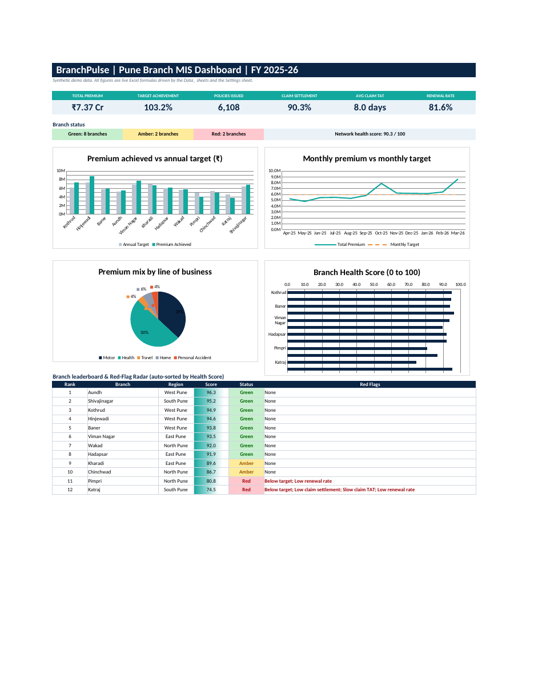

# BranchPulse: Branch MIS Automation for Insurance Operations

> **Turn messy branch data into a Monday-morning MIS pack, dashboard and email in one command.**

   



## The problem
Branch MIS teams spend hours every week copying data between sheets, fixing typos in branch codes, rebuilding pivot tables and writing the same summary email. One wrong lookup and the whole report is off.

## What BranchPulse does
| Feature | What it gives you |
|---|---|
| **Data Quality Gate** | Finds duplicates, bad branch codes, negative premiums, blank fields and orphan claims. Fixes or removes them and logs every action. |
| **Live Excel MIS pack** | Dashboard, branch summary, monthly trend, DQ report. Every number is a real formula (`SUMIFS`, `COUNTIFS`, `AVERAGEIFS`, `VLOOKUP`, `INDEX/MATCH`), so it keeps working when new data is pasted in. |
| **Branch Health Score (0 to 100)** | One number per branch that combines target achievement, claim settlement, renewal rate and claim turnaround. Weights are editable on the Settings sheet. |
| **Red-Flag Radar** | Auto-sorted leaderboard with Green / Amber / Red status and plain-English flags such as "Slow claim TAT". |
| **Reconciliation checks** | PASS / FAIL tests prove the report totals match the source data. |
| **Auto-written weekly email** | Subject line, key numbers, top and bottom branches and suggested actions, in professional English. |
| **SQL version of every KPI** | `sql/branch_kpis.sql` reproduces the Excel results, and I verified they match. |

## Quick start
```bash
git clone https://github.com/<your-username>/BranchPulse-MIS.git
cd BranchPulse-MIS
pip install -r requirements.txt
python run_all.py          # generates data, cleans it, builds Excel + email
python -m src.sql_demo     # optional: same KPIs in SQL
python tests/test_kpis.py  # unit tests (or: python -m pytest -q)
```
Then open `output/BranchPulse_MIS_Report.xlsx` (formulas calculate when Excel opens the file) and `output/weekly_mis_email.html`.

## How it works
```
generate_data.py  ->  clean_data.py  ->  build_workbook.py  ->  Excel MIS pack
 (messy raw CSVs)     (Quality Gate +     (live formulas,       email_digest.py -> weekly email
                       audit log)          charts, RAG rules)    sql_demo.py     -> SQL cross-check
```

## Skills demonstrated
- **Advanced MS Excel:** `VLOOKUP`, `SUMIFS`, `COUNTIFS`, `AVERAGEIFS`, `INDEX/MATCH`, `LARGE`, `RANK`, conditional formatting, data bars, charts, dashboard design
- **MIS reporting:** KPI design, branch-level reporting, reconciliation, exception reporting
- **Data cleaning and validation:** duplicate, null and orphan-record handling with an audit trail
- **SQL:** joins, conditional aggregation, month-by-category pivots
- **Python:** pandas, openpyxl, automation, unit tests
- **Business communication:** auto-generated management email

## Results on the demo data
- 12 branches, 6,108 clean policies, 505 claims, 3,301 renewals due
- 76 data issues found and handled; all 6 reconciliation checks pass
- Network premium: 103.2% of target. Two branches (Pimpri, Katraj) flagged Red with specific reasons

## Project structure
```
BranchPulse-MIS/
├── run_all.py            # one-command pipeline
├── src/                  # generate, clean, KPI logic, workbook, email, SQL demo
├── sql/branch_kpis.sql   # SQL versions of the KPIs
├── tests/test_kpis.py    # unit tests
├── docs/                 # screenshot, data dictionary, PivotTable guide
├── data/raw, data/clean  # messy input and cleaned output (synthetic)
└── output/               # Excel pack, email, data-quality log
```

## Notes
- **All data is synthetic.** Branch names are real Pune localities, but managers, figures and claims are invented. This project has no connection to any insurer.
- The workbook uses formula-driven pivots. For a native PivotTable, see `docs/pivot_table_guide.md`.
- Screenshot rendered with LibreOffice; Excel will look slightly different.

## Ideas for next steps
Power BI version of the dashboard, scheduled email sending via SMTP, a Streamlit front end, loss-ratio and agent-level reporting.

## Author
**Bhagyashree Ghosh** | Data Science & Analytics | [LinkedIn](https://www.linkedin.com/in/bhagyashreeg4/) | [GitHub](https://github.com/bhagyashreeghosh004-hub)

MIT License
